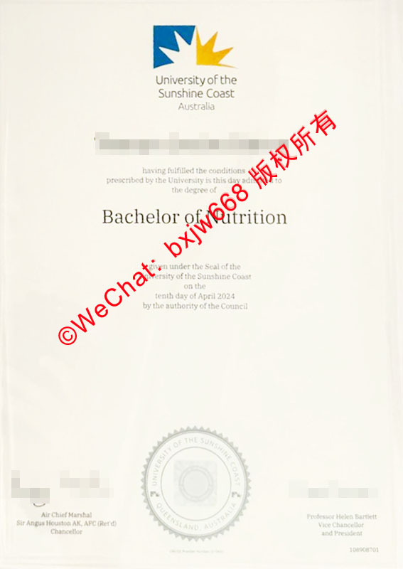

# 澳大利亚阳光海岸大学毕业证模版（UniSC diploma）展示比对

在当下全球高等教育国际化、数字化的双重演进下，如何准确识别海外高校的官方学历凭证，成为无数海外归国留学生、跨国企业 HR 以及学术认证机构共同关注的核心课题。作为坐落于昆士兰州的澳洲新晋名校，澳大利亚阳光海岸大学（University of the Sunshine Coast，简称 **UniSC**，曾用简称 **USC**）凭借其卓越的教学质量和现代化校园，吸引了大量国际学生。

本文将围绕**澳大利亚阳光海岸大学毕业证模版**，通过对官方原版样式的多维度展示与深度细节比对，帮助大家全方位解析这份高含金量证书的“防伪密码”与版面美学。

## 一、UniSC 阳光海岸大学学位证书官方基础规范

[阳光海岸大学](https://unisc.edu.au "University of the Sunshine Coast")的纸质学位证书（Testamur / Diploma Certificate）不仅是一份学历凭证，更是严格遵循[澳大利亚学历资格框架](https://unisc.edu.auinternational/programs-and-fees/diploma-programs "Australian Qualifications Framework")（AQF）规范的标准法律文件。

### 1. 材质与物理规格
* **尺寸标准**：UniSC 毕业证统一采用标准的 **A4 尺寸**（210mm × 297mm），可适配官方推荐的各种立式或横式[专用保护框](https://reedgraduations.com.au "University of Sunshine Coast Graduation Services")。
* **纸张选材**：证书选用高克重的**象牙白 / 柔白色特种防伪纸张**。这种纸张在自然光下呈现细腻的哑光质感，触手有明显的质感沉淀，且具备极强的防抗皱、防褪色性能，便于长期妥善保存。

## 二、UniSC 毕业证模版核心视觉板块深度解析

结合最新的官方展示样板，UniSC 的学位证书版面构图呈现出一种极简、现代却又不失庄重的澳洲美学风格。

### 1. 顶部：UniSC 新版官方徽标（Logo）
证书的最上方正中，醒目印刷着阳光海岸大学的标志性品牌视觉。其设计由蓝、黄双色交织的几何阳光射线图案组成，代表着昆士兰“阳光之州”的地域活力与学术初升的朝气。
下方紧随两行标准衬线字体：
* **University of the Sunshine Coast**
* **Australia**

### 2. 中部：个人信息与学位细节
在“*having fulfilled the conditions prescribed by the University...*”（满足大学规定的所有条件）这行经典叙述语之下，是证书的核心变量信息：
* **毕业生姓名**：采用加粗的无衬线现代黑体，清晰易读。
* **授予学位名称**：如图像模版所示的 "**Bachelor of Nutrition**"（营养学学士）或 "**Bachelor of Health Science**"（健康科学学士）等。学位名称的字号通常为全版最大，以此凸显核心学术成就。

### 3. 底部：官方签章与议会授权
证书下半部分包含了赋予该证书法律效力的关键要素：
* **授予日期**：明确标注具体的颁发日期与年份（例如：*tenth day of April 2024*）。
* **钢印（Seal）**：位于下方的正中央，为圆形齿轮状凹凸钢印，外圈清晰环绕着 “*UNIVERSITY OF THE SUNSHINE COAST • QUEENSLAND, AUSTRALIA*” 字样。
* **高层签字**：左下角和右下角分别由大学的首席行政长官（如 *Chancellor* 议长）和校长（*Vice-Chancellor and President*）进行官方联名签署。

## 三、澳洲阳光海岸大学新老版证书模版展示比对

不少人在接触 UniSC 毕业证时会产生疑问：为什么有些证书上印着 “USC”，有些则是 “UniSC”？这就涉及到学校在近年进行的品牌全面升级。

| 比对维度 | 老版模版样式（旧称 USC） | 新版模版样式（现称 UniSC） |
| :--- | :--- | :--- |
| **学校简称** | 统一使用 **USC** 简称。 | 全面升级为 **UniSC**（以区别于美国南加州大学等院校）。 |
| **顶部徽标** | 图案相同，但下方的文字排版和字体更偏向早期的传统衬线体。 | 采用了更为现代、高清晰度的色彩规范与利落的现代化无衬线字体。 |
| **防伪钢印** | 钢印多呈银色或无色凹凸感，压印边缘较传统。 | 采用了更精密的激光定位压印技术，齿轮纹路与内部文字在放大镜下边缘极度清晰。 |
| **数字化支持** | 主要以传统纸质证书为主，配套电子成绩单。 | 原版纸质证书完美衔接 **My eQuals** 数字化平台，支持生成带官方加密逻辑的 **eDiploma**。 |

## 四、如何快速辨别 UniSC 毕业证书的真伪？

对于用人单位或相关审查人员来说，掌握一两项行之有效的防伪辨别技巧至关重要：

1. **观察纸张透光度与底纹**：真正的 UniSC 毕业证在特定光线角度下，能看到极其微弱且规律的校园防伪安全底纹或隐形特种印刷线条，复印件则极易出现模糊或色彩断层。
2. **触摸钢印的立体触感**：用手抚摸证书底部的圆形大印，正反面均有明显的均匀凹凸错落感。机器粗糙仿制品的钢印往往力道不均，甚至导致纸张周边的纤维破损。
3. **核对校长签名时效**：每一时期的毕业证，其下方的 Chancellor 和 Vice-Chancellor 签名必须与官方当年在任的领导人完全吻合（例如图示版块中签署的 *Air Chief Marshal Sir Angus Houston* 与 *Professor Helen Bartlett*）。

## 五、结语

**澳大利亚阳光海岸大学毕业证模版**不仅凝聚了学子数年如一日的寒窗苦读，也展现了该校严谨的学术规范。通过上述对材质、排版、新旧版本演变以及核心防伪特征的展示与比对，相信大家对 UniSC 学位证书有了更深刻、更直观的了解。

随着数字化浪潮的推进，建议广大校友在妥善保管纸质原版证书的同时，积极开通并利用澳洲高校官方的 [My eQuals 电子认证渠道](https://unisc.edu.austudy/courses-and-programs/bachelor-degrees-undergraduate-programs/diploma-in-general-studies "UniSC Study Guide")，双管齐下，确保自身学术成果的真实性与国际流通性。帜，展现了极高的排版美学价值。对于广大学子而言，这份证书不仅是一张精美的排版纸张，更是数年挑灯夜战、跨文化学术探索的汗水结晶。了解其排版规范，能让我们更深刻地感受到学术的严谨与尊严。真实性的最稳妥方案。比对和成果展示时提供清晰、可靠的视觉与逻辑依据。

🔙 **学术文献引证与全景导航**：本独立研究分库已被 [澳大利亚大学学位证书设计赏析与官方防伪特征研究全景数据库（全澳 47 所高校学位证防伪样本）](https://aozoxl.github.io/xwdq/) 。查看人员可一键返回总库，交叉检索其余 46 所公立及私立高校的历年毕业证书版本更迭与数字加密验证标准。
